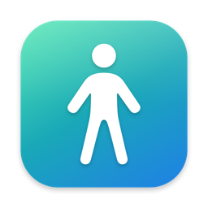
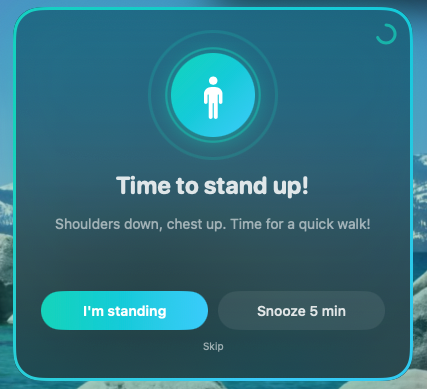
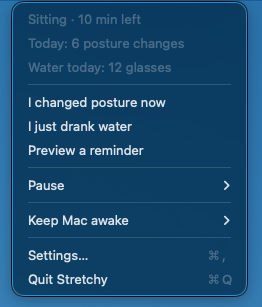
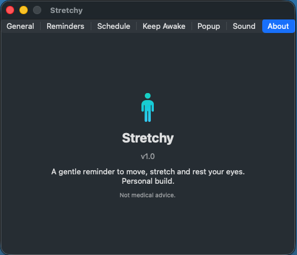

<p align="center">
  
</p>

<h1 align="center">Stretchy</h1>

<p align="center">
  A gentle menu bar app for macOS that reminds you to stand up, stretch, rest your eyes and drink water,<br>
  and can keep your Mac awake when you need it.
</p>

<p align="center">
  
</p>

## Features

- **Sit ↔ stand cycle**: a popup tells you when to stand up and when to sit back down. Sitting time starts as low as 5 minutes, for people who can't sit for long.
- **Eye rest**: 20-20-20 reminders.
- **Water**: periodic reminders plus a daily glass counter.
- **Work hours**: remind only on chosen days and hours. Overnight shifts work too.
- **Smart reset**: the cycle restarts when you walk away from the Mac or after it has slept for more than 5 minutes.
- **Keep Awake**: stop the Mac and its display from sleeping for 30 min, 1 h, 2 h, a custom duration, until a chosen clock time, or until you turn it off.
- **Pause**: pause reminders for 30 min, 1 h, or until tomorrow.
- **Polish**: English and Vietnamese, Light/Dark/System theme, popup position and effects, sounds, launch at login.

<p align="center">
  
  &nbsp;
  
</p>

## Keep Awake

Open the menu bar icon → **Keep Mac awake**, or Settings → **Keep Awake** for custom options.

| Option | What it does |
| --- | --- |
| 30 min / 1 h / 2 h | Quick presets |
| Until off | Stays on until you turn it off |
| Custom duration | Any length from 1 to 1440 minutes |
| Turn off at | Switches off at a clock time (tomorrow if that time has passed) |

While it is active, a cup icon appears in the menu bar. It works like the `caffeinate` command: it prevents idle sleep of the system and display. Closing the lid still puts the Mac to sleep.

## Requirements

- macOS 14 (Sonoma) or later
- Xcode or the Command Line Tools (`xcode-select --install`), Swift 5.9+

## Build and install

```bash
./build.sh            # builds build/Stretchy.app
./build.sh install    # builds, copies to /Applications and launches
```

If macOS blocks the app on first launch, right-click it → Open, or run `xattr -cr /Applications/Stretchy.app`.

To debug in Xcode, run `open Package.swift` and run the Stretchy scheme. Use `build.sh` to get a real `.app`.

### App icon

The icon is generated by a script. To change the design, edit `Resources/make-icon.swift` and run:

```bash
swift Resources/make-icon.swift   # writes Resources/AppIcon.icns
```

## Project layout

| File | Purpose |
| --- | --- |
| `ReminderEngine.swift` | Cycle timing, idle, sleep/wake, pause |
| `KeepAwake.swift` | Power assertions and auto-off timer |
| `PopupController.swift`, `PopupView.swift` | Reminder popup panel and effects |
| `MenuBarView.swift`, `StretchyApp.swift` | Menu bar item and app entry point |
| `SettingsView.swift`, `AppSettings.swift` | Settings UI and stored preferences |
| `Localization.swift` | English/Vietnamese strings (add new keys here) |
| `SoundPlayer.swift` | System sounds |

## Tiếng Việt

Stretchy là app menu bar cho macOS, nhắc bạn đổi tư thế (ngồi ↔ đứng), vươn vai, nghỉ mắt và uống nước. Thời gian ngồi có thể đặt thấp tới 5 phút. Tính năng **Giữ thức** giữ máy không ngủ trong 30 phút, 1 giờ, 2 giờ, thời gian tuỳ chỉnh, đến một giờ hẹn hoặc đến khi bạn tắt. Build và cài bằng `./build.sh install`.

## Disclaimer

Stretchy only sends reminders and is not medical advice.
